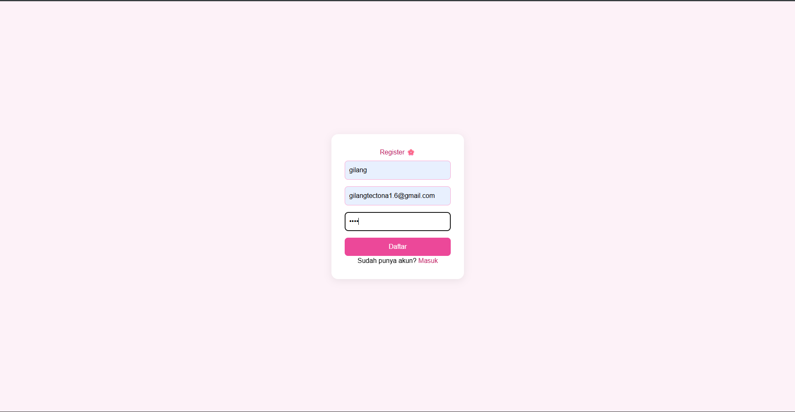
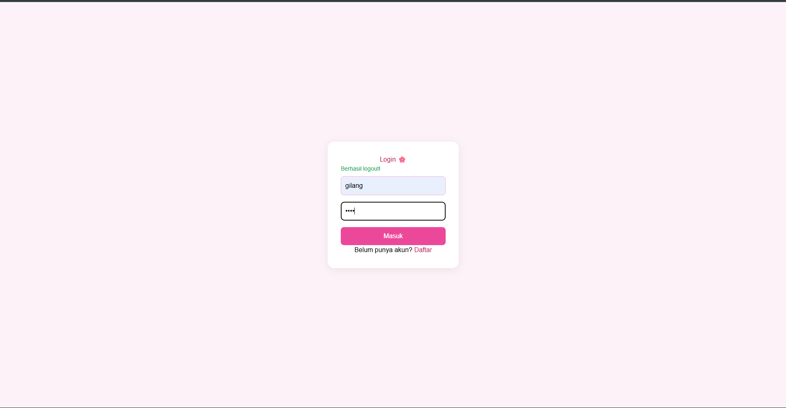
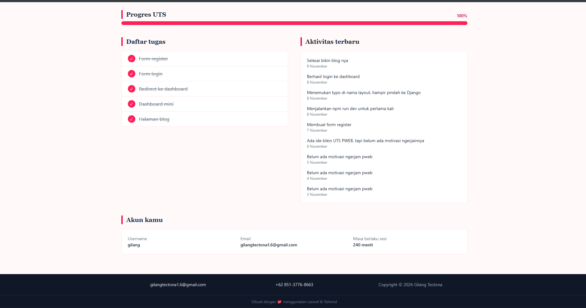
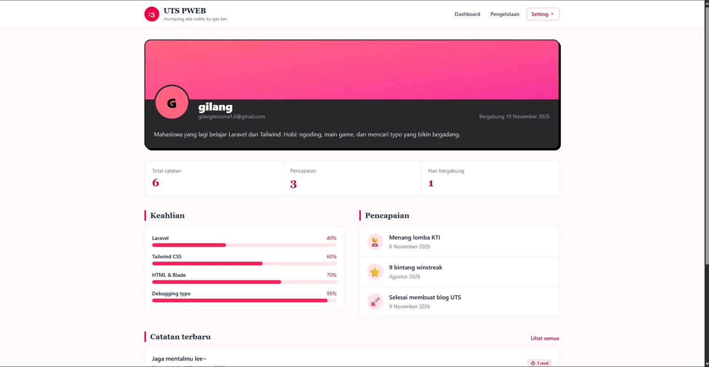

# UTS PWEB — Blog Pribadi "Pengelolaan Catatan"

Nama : Gilang Tectona
NIM  : 252410103055

## Ini web apa?

Web sederhana buat nyatet hal-hal yang lagi kupelajari, kesalahan yang kubuat, sama prestasi yang kudapat. Temanya **pengelolaan catatan**: semua catatan disimpan di array di Controller, lalu ditampilkan sebagai kartu di halaman Pengelolaan.

Alurnya: **Register → Login → Dashboard → Profil → Pengelolaan**.

Dibuat pakai Laravel 13 + Blade + Tailwind CSS 4 (lewat Vite). Tanpa starter kit, tanpa database. Data akun cuma disimpan di session, jadi ini murni simulasi login.

## Screenshot

### Register


### Login


### Dashboard
Ada sapaan pakai username, ringkasan progres, daftar tugas, aktivitas terbaru, dan info akun di bagian bawah. (sekaligus dengan navbar)


### Foter
Bagian footer menampilkan email, nomer ku, dan copyright



### Pengelolaan
Daftar catatan dari Controller, dirender pakai `@foreach` jadi kartu-kartu.


### Profil
Halaman sendiri (bukan modal), isinya identitas, keahlian, pencapaian, dan catatan terbaru.



## Struktur utama

```
routes/web.php
app/Http/Controllers/AuthController.php   (register, login, logout)
app/Http/Controllers/PageController.php   (dashboard, pengelolaan, profil)
app/Http/Middleware/EnsureLoggedIn.php    (jaga halaman yang butuh login)
resources/views/
├── layouts/app.blade.php
├── dashboard.blade.php
├── pengelolaan.blade.php
├── profile.blade.php
├── logreg/login.blade.php
├── logreg/register.blade.php
└── components/
    ├── navbar.blade.php
    ├── footer.blade.php
    ├── nav-link.blade.php
    ├── dropdown.blade.php
    └── dropdown-link.blade.php
```

## Yang dipakai

- **Blade:** `@extends`, `@section`, `@yield`, `@include`, `@foreach`, dan komponen `<x-nav-link>`, `<x-dropdown>`, `<x-dropdown-link>`.
- **MVC:** semua data (tugas, aktivitas, catatan, keahlian) dibuat di Controller lalu dikirim ke View.
- **Username** dari form login dibawa ke Dashboard dan Profil.
- **Middleware** `logged_in` supaya Dashboard, Pengelolaan, dan Profil gak bisa dibuka sebelum login.

## Cara menjalankan

```bash
composer install
npm install
cp .env.example .env
php artisan key:generate
npm run dev        # terminal 1
php artisan serve  # terminal 2
```

Buka `http://127.0.0.1:8000`, daftar dulu di halaman Register, lalu login.